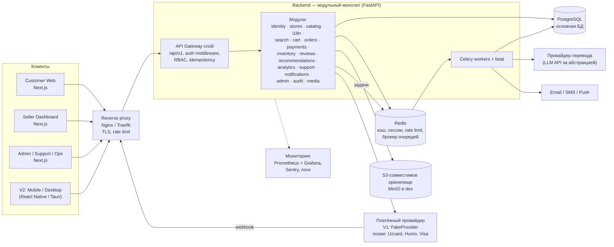

# 1. Архитектура системы

## 1.1 Принципы

- **Модульный монолит.** Один деплой бэкенда, но код разделён на независимые модули (bounded contexts) с явными публичными интерфейсами. Модуль не лезет в таблицы другого модуля напрямую, только через его сервисный слой или доменные события. Это позволит позже вынести, например, `search` или `payments` в отдельный сервис без переписывания.
- **API-first.** Все клиенты (веб сейчас, мобильные и десктоп в V2) работают через один REST API `/api/v1/`. Никакой бизнес-логики во фронтенде.
- **Слои внутри модуля:** `api` (роутеры FastAPI, схемы Pydantic) → `service` (бизнес-логика, транзакции) → `repository` (SQLAlchemy) → `models`. Плюс `events` (публикуемые/обрабатываемые события) и `tasks` (фоновые задачи Celery).
- **Асинхронность там, где не нужен ответ сразу:** переводы, индексация поиска, пересчёт рекомендаций, агрегаты аналитики, уведомления, вебхуки.

## 1.2 Контекстная схема

## 1.3 Модули бэкенда

| Модуль | Ответственность | Владеет таблицами |
|---|---|---|
| `identity` | Регистрация, вход, токены, сессии, роли и права | User, Role, Permission, UserRole, Session, RefreshToken |
| `stores` | Магазины, заявки продавцов, сотрудники магазина | Store, StoreMembership, SellerApplication |
| `catalog` | Товары, варианты, категории, бренды, атрибуты, изображения | Product, ProductVariant, Category, Brand, ProductImage |
| `i18n` | Переводы контента, очередь автоперевода, словари UI | ProductTranslation, CategoryTranslation, TranslationJob |
| `inventory` | Остатки, резервы, движение склада | Inventory, StockReservation, StockMovement |
| `search` | Полнотекстовый поиск, фильтры, подсказки, история поиска | SearchHistory, search-индекс |
| `cart` | Корзина, расчёт сумм | Cart, CartItem |
| `orders` | Родительский заказ, заказы продавцов, статусы, возвраты товара | Order, SellerOrder, OrderItem, OrderStatusHistory, ReturnRequest |
| `payments` | Платежи, провайдеры, вебхуки, возвраты денег, комиссия | Payment, PaymentAttempt, Refund, WebhookEvent, LedgerEntry |
| `reviews` | Отзывы и рейтинги | Review |
| `engagement` | Избранное, просмотры | Favorite, ProductView |
| `recommendations` | Персональные подборки, тренды, бестселлеры недели | Recommendation |
| `analytics` | Агрегаты продаж, конверсии, показов для продавцов | SellerDailyStats, ProductDailyStats |
| `support` | Тикеты и переписка | SupportTicket, SupportMessage |
| `notifications` | In-app, email, SMS, push | Notification, NotificationPreference |
| `media` | Загрузка файлов, проверка, ресайз | MediaFile |
| `audit` | Неизменяемый журнал чувствительных действий | AuditLog |
| `platform` | Настройки платформы, feature flags, health | PlatformSetting |

**Правило зависимостей:** модуль импортирует только `service`-интерфейсы других модулей (или подписывается на их события). Проверяется автоматически линтером импортов (`import-linter`) в CI.

## 1.4 Доменные события (внутренняя шина)

В V1 события публикуются внутри процесса (in-process event bus) с паттерном **Transactional Outbox**: событие пишется в таблицу `outbox` в той же транзакции, что и изменение, а воркер доставляет его обработчикам. Так ничего не теряется при сбое, и позже шину можно заменить на брокер (RabbitMQ/Kafka) без изменения модулей.

Примеры: `ProductCreated` → перевод + индексация; `OrderPlaced` → резерв остатков + уведомление продавцам; `PaymentSucceeded` → подтверждение заказа; `RefundCompleted` → возврат остатков + запись в аудит.

## 1.5 Фронтенды

Один монорепозиторий фронтенда (pnpm workspaces + Turborepo):

- `apps/web` — покупатель (SSR/ISR для SEO каталога и карточек).
- `apps/seller` — панель продавца (SPA-режим, за авторизацией).
- `apps/admin` — админка, поддержка, финансы, тех. операции.
- `packages/ui` — дизайн-система (токены, компоненты на Tailwind).
- `packages/api-client` — типизированный клиент, **генерируется из OpenAPI** бэкенда.
- `packages/i18n` — словари интерфейса uz/ru/en.

Это же `api-client` и словари переиспользуются в V2 (React Native), если выбрать его.
