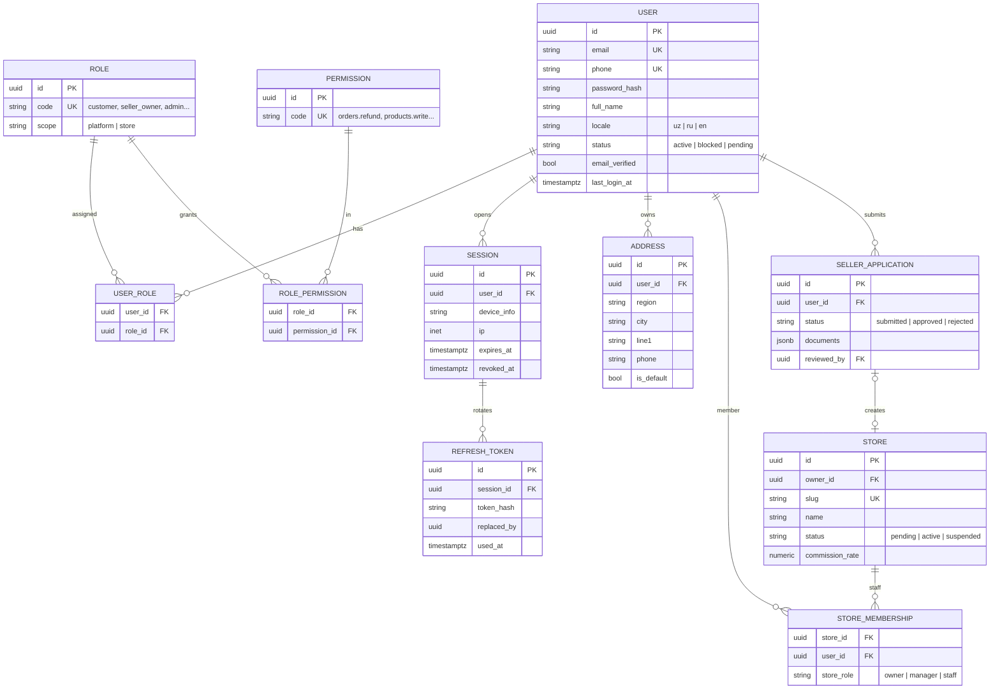
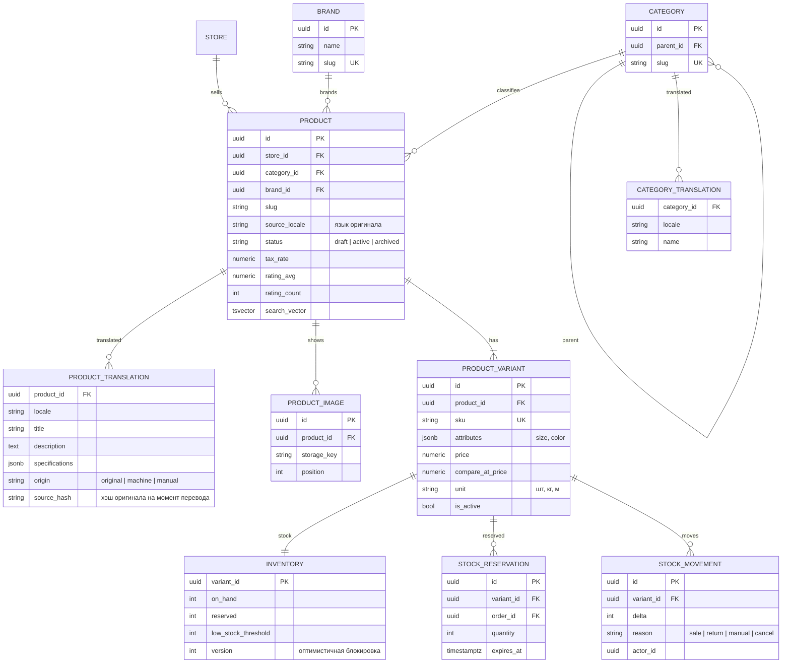
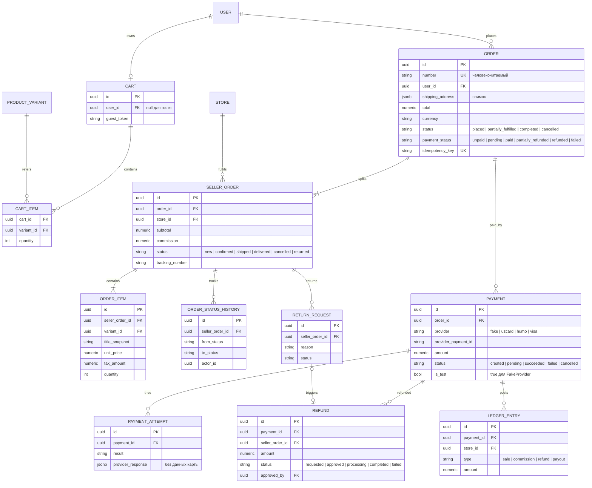
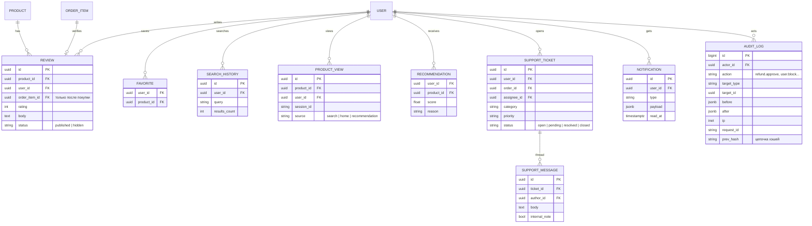

# 3. Модель данных (ER)

Общие соглашения:
- Первичные ключи `UUID` (v7, сортируемые по времени): безопасно отдавать наружу, не раскрывают объёмы.
- У всех таблиц `created_at`, `updated_at`; у удаляемых пользователем сущностей — `deleted_at` (мягкое удаление).
- Деньги: `NUMERIC(14,2)` + `currency` (ISO 4217, по умолчанию `UZS`). Никаких float.
- Все таблицы с данными продавца содержат `store_id`, и все запросы продавца фильтруются по нему на уровне репозитория (см. раздел безопасности, там же про PostgreSQL RLS как второй рубеж).

## 3.1 Identity и магазины

## 3.2 Каталог, переводы, склад

**Скидки:** в V1 скидка задаётся через `compare_at_price` на варианте (старая цена) плюс таблица `DISCOUNT` (процент/сумма, период действия, область: товар/магазин). Промокоды — V1.1.

## 3.3 Корзина, заказы, платежи

**Ключевые правила:**
- Один checkout → один `ORDER` (родитель) → по одному `SELLER_ORDER` на каждый магазин.
- `ORDER.status` и `ORDER.payment_status` независимы; статус каждого `SELLER_ORDER` тоже независим.
- Цены, название товара и адрес **копируются** в заказ (снимок), чтобы изменения каталога не меняли историю.
- Списание остатков: `UPDATE inventory SET reserved = reserved + :q WHERE variant_id = :id AND on_hand - reserved >= :q` в транзакции — атомарно, без гонок. Резерв истекает, если оплата не прошла за N минут.
- `LEDGER_ENTRY` — двойная запись для финансов: продажа, комиссия платформы, возврат, выплата. Только вставка, никаких UPDATE/DELETE.

## 3.4 Вовлечённость, поддержка, аудит

- `PRODUCT_VIEW` и `SEARCH_HISTORY` — высоконагруженные таблицы: партиционирование по месяцу, хранение сырых данных 90 дней, дальше только агрегаты.
- `AUDIT_LOG` — только вставка (права БД на UPDATE/DELETE отозваны), цепочка хэшей для обнаружения подмены.
- Аналитика продавца считается не из сырых таблиц на лету, а из ночных/почасовых агрегатов `SELLER_DAILY_STATS`, `PRODUCT_DAILY_STATS` (просмотры, показы в поиске, добавления в корзину, заказы, выручка).
