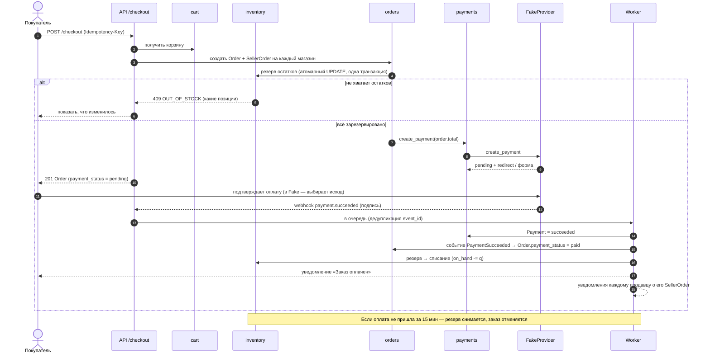
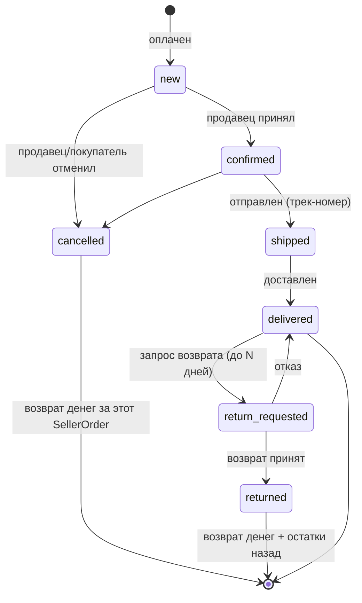
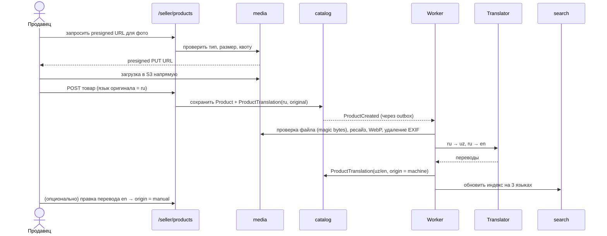
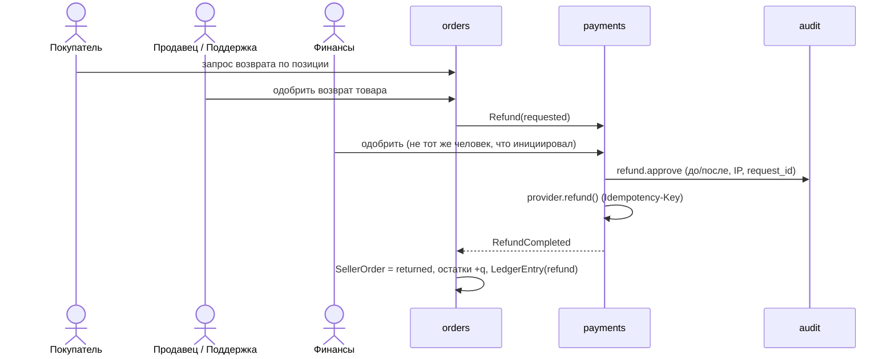

# 6. Основные сценарии

## 6.1 Checkout с несколькими продавцами

## 6.2 Жизненный цикл заказа продавца

Родительский `Order.status` вычисляется из статусов всех `SellerOrder` (`completed`, если все доставлены/закрыты; `partially_fulfilled` и т. д.). Платёжный статус меняется отдельно: частичный возврат одного продавца даёт `payment_status = partially_refunded`.

## 6.3 Создание товара продавцом и автоперевод

## 6.4 Возврат денег

## 6.5 Регистрация продавца

Покупатель → «Стать продавцом» → заявка (название магазина, контакты, документы) → админ проверяет → одобрено: создаётся `Store` (status = active) и `StoreMembership(owner)`, пользователь получает роль `seller_owner` в этом магазине → доступ к панели продавца. Все шаги одобрения пишутся в аудит.

## 6.6 Рекомендации (V1, базовые)

- **Новый пользователь** (нет истории): «Хиты недели» = топ по продажам за 7 дней, отдельно по категориям.
- **С историей:** ночная задача считает оценку товаров: похожие на просмотренные/избранные/купленные (та же категория и бренд, близкая цена) + «покупают вместе» (совместные покупки). Результат — `Recommendation` в БД и кэш в Redis.
- **Тренды:** рост просмотров и добавлений в корзину за 24–72 часа.
- Интерфейс модуля позволит в будущем заменить алгоритм на ML-модель без изменения API `/home`.
