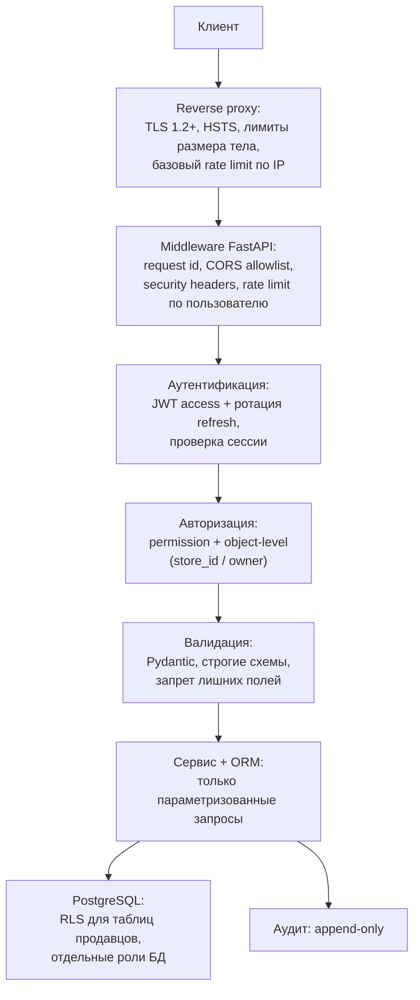

# 7. Архитектура безопасности

Ориентир — OWASP ASVS уровень 2 и OWASP API Security Top 10 (2023).

## 7.1 Слои защиты

## 7.2 Меры по пунктам

| Угроза / требование | Мера |
|---|---|
| Хранение паролей | **Argon2id** (`argon2-cffi`), проверка по списку утёкших паролей (k-anonymity HIBP, опционально), мин. длина 8 |
| Перебор паролей | Rate limit на `/auth/*` по IP и аккаунту, прогрессивная задержка, временная блокировка, CAPTCHA после N неудач |
| Токены | Access JWT 15 мин (подпись EdDSA/RS256, ключи с ротацией `kid`), refresh — случайная строка, в БД только хэш, ротация с детектом повторного использования |
| CSRF | Refresh-cookie `SameSite=Lax` + `HttpOnly`; эндпоинт `/auth/refresh` требует CSRF-токен (double submit). Остальные запросы идут с `Authorization: Bearer`, cookie не используются |
| XSS | React экранирует вывод; описания товаров — Markdown → санитизация (`bleach`/`nh3`) на бэкенде; строгий CSP без `unsafe-inline` для скриптов |
| SQL-инъекции | Только SQLAlchemy с параметрами; сырой SQL — только через `text()` с bind-параметрами, проверяется ревью и линтером (`bandit`) |
| BOLA / изоляция продавцов | Object-level проверка в репозитории (`store_id` из членства, не из запроса) + **PostgreSQL Row-Level Security** как второй рубеж; автотесты «продавец A не видит данные B» для каждого эндпоинта `/seller` |
| Mass assignment | Отдельные Pydantic-схемы для создания/обновления, `extra = "forbid"`; цена, статус, store_id никогда не берутся из тела запроса покупателя |
| Загрузка файлов | Presigned URL с ограничением типа и размера, проверка magic bytes, перекодирование изображений (убирает вредоносное содержимое и EXIF), отдельный домен для раздачи, без исполнения |
| SSRF | Бэкенд не скачивает файлы по URL пользователя; исходящие запросы — только к allowlist провайдеров |
| Секреты | Не в репозитории: `.env` только локально, в prod — Docker secrets / Vault / секреты облака; `gitleaks` в CI |
| Платёжные данные | Номер карты и CVV никогда не попадают к нам (токенизация провайдера); вебхуки — HMAC + timestamp + дедупликация |
| Логи | Структурированные JSON, маскирование PII и токенов, без тел запросов с паролями |
| Заголовки | HSTS, CSP, `X-Content-Type-Options`, `Referrer-Policy`, `Permissions-Policy`, `frame-ancestors 'none'` |
| Зависимости | `pip-audit`, `npm audit`/`osv-scanner`, Dependabot, сканирование образов `trivy` |
| Бэкапы | Ежедневный `pg_dump` + WAL-архивирование (PITR) в отдельное хранилище, шифрование, ежемесячная проверка восстановления |
| Аудит | Append-only таблица, цепочка хэшей, отдельная роль БД без прав UPDATE/DELETE |

## 7.3 Подготовка к V3 уже в V1

- `Session` как отдельная сущность (устройство, IP, время) → основа для управления устройствами.
- Многошаговый вход (`next_step`) → 2FA/TOTP/passkeys добавляются как новые шаги.
- Таблица `user_credentials` (тип: password / totp / webauthn) вместо поля пароля в `User` → passkeys без миграции схемы пользователей.
- События входа (`LoginSucceeded`, `LoginFailed`) с IP и устройством пишутся с первого дня → данные для детекта подозрительных входов и антифрода.
- «Step-up»: чувствительные действия (🔒 в матрице) уже проходят через одну зависимость `require_sensitive_action()`; в V3 в неё добавляется повторное подтверждение 2FA.
