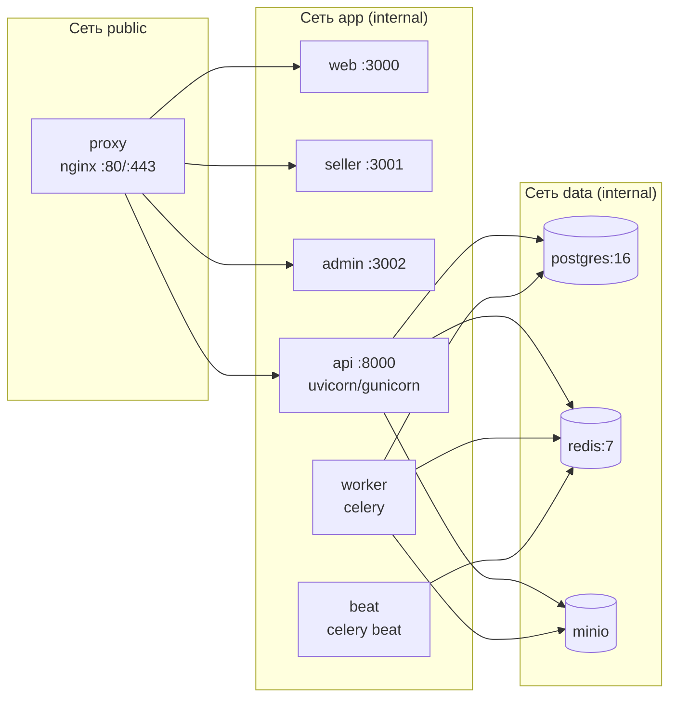

# 8. Docker-инфраструктура

## 8.1 Сервисы



| Сервис | Образ | Healthcheck | Тома |
|---|---|---|---|
| `proxy` | nginx:alpine | `GET /healthz` | конфиги, сертификаты |
| `web`, `seller`, `admin` | собственный (Next.js standalone, multi-stage) | `GET /api/health` | — |
| `api` | собственный (python:3.12-slim, non-root) | `GET /health/ready` | — |
| `migrate` | тот же образ, что `api` | одноразовый: `alembic upgrade head` перед стартом `api` | — |
| `worker`, `beat` | тот же образ, что `api` | `celery inspect ping` | — |
| `postgres` | postgres:16 | `pg_isready` | `pg_data` |
| `redis` | redis:7 (AOF включён) | `redis-cli ping` | `redis_data` |
| `minio` | minio/minio | `/minio/health/live` | `minio_data` |
| `mailpit` (только dev) | axllent/mailpit | — | — |
| `backup` (prod) | собственный, cron + pg_dump | — | `backups` |

Сеть `data` недоступна снаружи: БД, Redis и MinIO не публикуют порты в prod.

## 8.2 Конфигурации

- `docker-compose.yml` — общее описание сервисов.
- `docker-compose.dev.yml` — hot reload (монтирование кода), открытые порты БД для отладки, mailpit, `FAKE_PAYMENTS_ENABLED=true`.
- `docker-compose.prod.yml` — без монтирования кода, лимиты CPU/памяти, `restart: unless-stopped`, секреты через Docker secrets, `FAKE_PAYMENTS_ENABLED=false` по умолчанию.
- `.env.example` перечисляет все переменные с описанием; реальные `.env` в `.gitignore`.

## 8.3 Запуск разработки (целевой сценарий)

```bash
cp .env.example .env
make up          # docker compose -f ... up -d --build
make migrate     # alembic upgrade head
make seed        # демо-данные: категории, 3 магазина, товары, пользователи всех ролей
make test        # pytest + vitest внутри контейнеров
```

После этого: покупатель — `http://localhost`, продавец — `http://seller.localhost`, админка — `http://admin.localhost`, API-документация — `http://localhost/api/docs`.

## 8.4 Бэкапы

`infra/scripts/backup.sh`: `pg_dump -Fc` раз в сутки + архивирование WAL, хранение 7 дневных / 4 недельных / 6 месячных копий, шифрование, выгрузка во внешнее S3. `restore.sh` + инструкция; восстановление проверяется на staging раз в месяц.

## 8.5 Наблюдаемость

- Логи: JSON в stdout → (prod) Loki или аналог.
- Метрики: `prometheus-fastapi-instrumentator`, метрики Celery и PostgreSQL → Prometheus + Grafana. Эти данные показывает раздел «Тех. операции» админки.
- Ошибки: Sentry (self-hosted или облако), с маскированием PII.
- Трассировка: OpenTelemetry (заготовка в V1, включается флагом).
