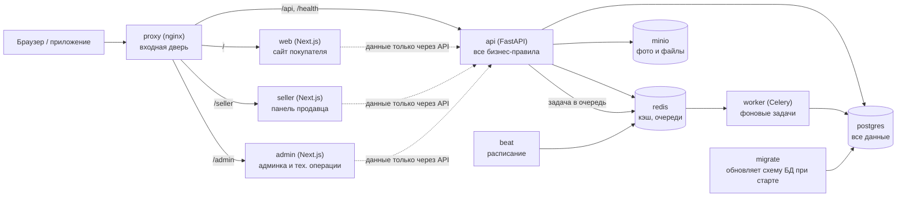
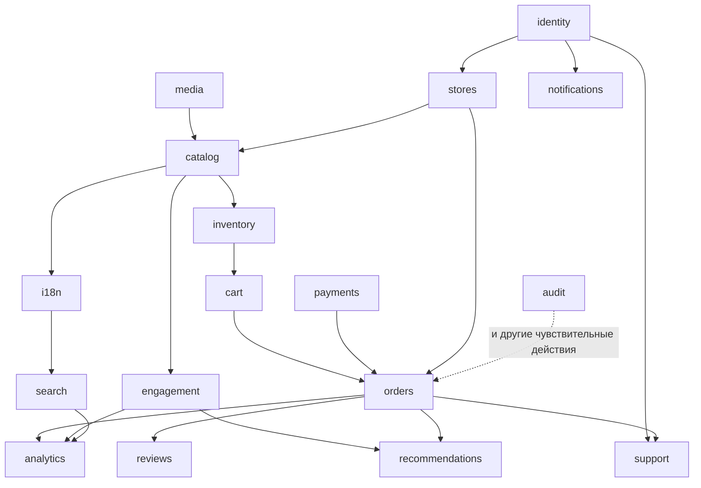

# 11. Как устроена система и где искать баг

Этот документ для владельца проекта: что за что отвечает, как части связаны и как быстро понять, где сломалось.

## 11.1 Из чего состоит система



| Сервис (контейнер) | Что делает | Если он упал |
|---|---|---|
| `proxy` | Принимает все запросы: `/api` и `/health` → `api`, `/seller` → `seller`, `/admin` → `admin`, остальное → `web` | Сайт вообще не открывается |
| `web` | Сайт покупателя (только интерфейс, данные берёт из API) | Не открывается витрина, панели работают |
| `seller` | Панель продавца | Не открывается `/seller` |
| `admin` | Админка, поддержка, финансы, тех. операции | Не открывается `/admin` |
| `api` | Обрабатывает запросы: вход, товары, заказы, платежи… | Все запросы получают ошибку 502 |
| `worker` | Делает долгую работу в фоне: переводы, письма, индексацию поиска | Сайт работает, но переводы и письма «застревают» |
| `beat` | Ставит задачи по расписанию (ночная аналитика, рекомендации) | Не обновляются аналитика и рекомендации |
| `migrate` | Один раз при старте обновляет таблицы БД и завершается | `api` не стартует, пока миграция не пройдёт |
| `postgres` | Хранит все данные | `/health/ready` показывает `database: down` |
| `redis` | Кэш, лимиты запросов, очередь задач | `/health/ready` показывает `redis: down`, фоновые задачи стоят |
| `minio` | Хранит изображения товаров | Не загружаются и не показываются фото |

Проверить состояние: `make ps` (статус и health каждого контейнера) и `http://localhost/health/ready` (база и Redis отдельно).

## 11.2 Внутри `api`: модули

Бэкенд — один сервис, разделённый на **18 модулей**. Каждый модуль лежит в `backend/app/modules/<имя>/`, и в каждом есть `README.md`: что модуль делает, от кого зависит, какие события шлёт и слушает и какие симптомы ведут к нему.

Живая карта модулей с их связями: страница **Тех. операции** в админке (`http://localhost/admin`) показывает состояние БД и Redis и все модули с зависимостями и событиями. Те же данные в JSON: `GET /api/v1/system/modules` (не в prod).



Стрелка `A --> B` значит: «B использует A». Если сломался A, проблемы могут быть и в B, но не наоборот.

### Правила, которые держат систему понятной

1. **Слои внутри модуля:** `api.py` (принимает HTTP) → `service.py` (бизнес-логика) → `repository.py` (запросы в БД) → `models.py` (таблицы).
2. **Модули общаются только через `service.py` и `events.py`** другого модуля и только с теми, кто указан в `depends_on` в `module.py`. Тест `tests/test_module_boundaries.py` ломает CI, если правило нарушено.
3. **Карта не врёт:** `tests/test_modules.py` проверяет, что у каждого модуля есть README, что зависимости существуют и не образуют цикл, а каждое слушаемое событие кто-то публикует.
4. **Долгая работа — в фоне через события.** Например, `catalog` сохраняет товар и публикует `ProductCreated`, а `i18n` и `search` в воркере переводят и индексируют его.

## 11.3 Как найти, где баг

Любая ошибка API выглядит так:

```json
{
  "status": 409,
  "code": "ORDERS.OUT_OF_STOCK",
  "module": "orders",
  "detail": "Not enough stock",
  "request_id": "3f9c2a1b7e8d4c6f9a0b1c2d3e4f5a6b"
}
```

- **`module`** — какой модуль обработал запрос. Открывайте `backend/app/modules/orders/`.
- **`code`** — какая именно ошибка (модуль + код).
- **`request_id`** — номер запроса. Тот же номер есть в заголовке ответа `X-Request-Id` и в **каждой строке лога** этого запроса.

Каждая строка лога — JSON с полями `module` и `request_id`:

```bash
make logs s=api | grep 3f9c2a1b7e8d4c6f9a0b1c2d3e4f5a6b
```

При внутренней ошибке (500) полный traceback пишется в лог с тем же `request_id`, а клиенту уходит только общий текст: подробности наружу не утекают.

На сайте ошибка показывается карточкой с кнопкой «Скопировать»: в ней уже есть код, модуль и ID запроса. Фронтенд сам отправляет `X-Request-Id` с каждым запросом, так что ID совпадает с тем, что в логах бэкенда.

**Чтобы сообщить о баге,** достаточно прислать: что делали, `request_id` (из ответа или из DevTools → Network → заголовок `X-Request-Id`) и `code`.

### Симптом → куда смотреть

| Симптом | Модуль | Где ещё проверить |
|---|---|---|
| Не входит, разлогинивает, 403 «нет доступа» | `identity` | Роли пользователя, срок токена |
| Продавец не видит свою панель или магазин | `stores` | Членство в магазине, статус заявки |
| Товар не сохраняется, неверная цена | `catalog` | Ошибка валидации (`VALIDATION_ERROR`, поле `errors`) |
| Нет перевода на uz/en | `i18n` | Контейнер `worker` жив? |
| Товар не находится в поиске | `search` | `worker` (индексация), есть ли перевод |
| «Нет в наличии», хотя товар есть | `inventory` | Резервы неоплаченных заказов |
| Не добавляется в корзину, неверная сумма | `cart` | Остатки, активен ли вариант |
| Заказ не создаётся или не разделился по продавцам | `orders` | `inventory`, `payments` |
| Оплата зависла, двойное списание | `payments` | Вебхуки, `Idempotency-Key` |
| Не пришло письмо или уведомление | `notifications` | `worker`, mailpit (`http://localhost:8025` в dev) |
| Не грузятся фото | `media` | Контейнер `minio` |
| Цифры в дашборде продавца не сходятся | `analytics` | `beat` (ночные пересчёты) |
| Сайт не открывается совсем | — | `make ps`: `proxy` и `api` здоровы? |
| Страница сайта белая или «Что-то пошло не так» без кода модуля | фронтенд | `make logs s=web` (или `seller` / `admin`), консоль браузера |
| Всё медленно или 503 | — | `/health/ready`: `database` / `redis` |

## 11.4 Где что лежит в коде

| Что | Где |
|---|---|
| Точка входа, подключение модулей | `backend/app/main.py` |
| Список всех модулей | `backend/app/modules/__init__.py` |
| Настройки (из `.env`) | `backend/app/core/config.py` |
| Формат ошибок | `backend/app/core/errors.py` |
| `request_id` и лог каждого запроса | `backend/app/core/middleware.py`, `backend/app/core/logging.py` |
| Подключение к БД | `backend/app/core/db.py` |
| Health и карта модулей | `backend/app/system.py` |
| Фоновые задачи | `backend/app/workers/celery_app.py` |
| Миграции БД | `backend/migrations/versions/` |
| Фронтенд: приложения | `frontend/apps/web`, `frontend/apps/seller`, `frontend/apps/admin` |
| Фронтенд: дизайн-система (цвета, кнопки, карточка ошибки) | `frontend/packages/ui` |
| Фронтенд: тексты интерфейса uz/ru/en | `frontend/packages/i18n/src/locales/` |
| Фронтенд: клиент API (request_id, разбор ошибок) | `frontend/packages/api-client` |
| Docker | `infra/compose/`, `backend/Dockerfile`, `frontend/Dockerfile`, `infra/docker/nginx/` |
| Команды | `Makefile` (`make help`) |
